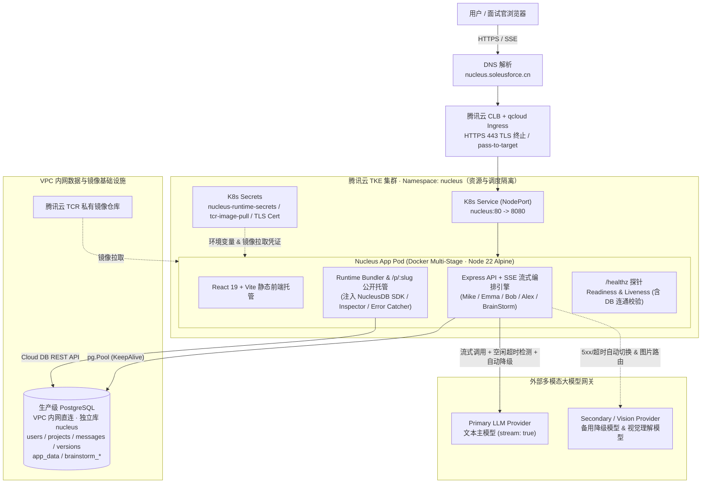

# Nucleus — AI-Native Multi-Agent App Studio 笔试交付说明

> **在线体验地址**：`https://nucleus.soleusforce.cn`（支持**一键访客免注册体验**，也支持邮箱注册登录）  
> **GitHub 源码地址**：`https://github.com/wuweiliang1/nucleus_prototype`

---

## 一、产品定位与核心体验路径

**Nucleus** 是一个面向“从想法到可运行云端全栈应用”的 AI-Native 多智能体应用构建平台。核心设计对标 Atoms 的虚拟研发团队与云端托管理念，并在此基础上延伸出了**「BrainStorm 项目圆桌（脑暴 Meeting 模式）」**与**「多模态设计稿输入」**。

### 推荐 3 分钟核心体验路径
1. **一键进入**：访问 `https://nucleus.soleusforce.cn`，点击右上角「登录 / 访客体验」→「一键访客免注册体验」。
2. **多智能体协同建站**：在首页输入一句话需求（或直接点击精选模板、支持粘贴/上传最多 3 张参考图），进入 Studio 后观察左侧 **Mike（Team Lead）→ Emma（PM）→ Bob（Architect）→ Alex（Full-Stack Engineer）** 接力完成 PRD、架构蓝图、数据模型与多文件代码构建。
3. **体验亮点 —— BrainStorm 项目圆桌（Meeting 模式）**：
   - 在工作台打开 **BrainStorm**，可选择**「人类参会」**或**「AI 圆桌」**模式，自由邀请 1~6 位参会者（包含 4 位研发角色 + 4 位虚拟测评者：`首次使用者`、`重度用户`、`业务采购方`、`无障碍测评者`），并可附上截图/设计稿逐轮讨论。
   - 讨论结束后可指定参会角色起草结构化会议纪要，支持人工编辑确认、导出 Markdown，并**一键 Handoff 给 Mike 推进已确认事项落地为代码**。
4. **可视化点选修改 + 运行时自愈**：
   - 在右侧 Preview 开启 **「点选编辑 (Select-to-Edit)」**，悬停并点击画面任意 DOM 元素，自动携带 Selector 与 HTML 片段发给 Alex 定向修改。
   - 若生成应用出现运行时 JS / Promise 异常，沙箱自动捕获并弹出「一键让 Alex 修复」横幅。
5. **Nucleus Cloud 真实持久化 + 一键发布**：
   - 切换至 **「PRD & DB → Nucleus Cloud DB」**，可直接看到生成应用通过注入的 `window.NucleusDB` SDK 写入生产级 PostgreSQL 的真实数据行。
   - 点击右上角 **「发布上线」**，立即生成可独立访问和分享的公开 URL（`https://nucleus.soleusforce.cn/p/<slug>`），支持社区 Showcase 展示与一键 **Remix**。

---

## 二、实现思路与关键工程取舍

### 1. 现网生产级部署架构（TKE + PostgreSQL）
区别于常见的静态托管或内存/本地 SQLite 原型，Nucleus 直接按照**现网生产标准**部署在腾讯云 TKE Kubernetes 集群的独立 Namespace（`nucleus`）中，具备完整的网络隔离、健康探针、密钥管理与持久化能力：

**生产级工程细节落地点**：
- **容器与调度隔离**：单仓库多阶段 `Dockerfile` 构建精简 Alpine 镜像推入私有 TCR；通过独立 `nucleus` Namespace、CPU/Memory `requests/limits` 配额及 `tolerations` 隔离业务节点，零侵入复用集群基础设施。
- **全链路高可用**：配置 K8s `readinessProbe` / `livenessProbe`（`/healthz` 实时探测 PostgreSQL 连通性）；PostgreSQL 连接池启用 `keepAlive` 与异常监听，杜绝瞬断导致进程退出；针对 CLB 60s 空闲断连与网关超时，实现**下游 8s SSE 心跳保活 + 上游流式空闲超时检测 + 主/备与视觉模型自动降级重试**。
- **数据模型与多租户隔离（PostgreSQL）**：在独立 `nucleus` 数据库中自动完成表结构初始化，涵盖 `users`、`projects`、`messages`、`project_versions`、`app_data`（按 `project_id + collection` 逻辑隔离的应用级云端持久化存储），以及 BrainStorm 圆桌会议的 `sessions / turns / minutes`（含 `revision` 乐观锁与 `lease_token` 并发租约）。

### 2. 关键架构与工程取舍

| 决策点 | 采取的方案 | 放弃的方案 | 取舍原因 |
| :--- | :--- | :--- | :--- |
| **应用运行与预览沙箱** | 浏览器内多文件组装 + `iframe` 沙箱，自动注入 `window.NucleusDB` SDK、点选 Inspector 和 Error Catcher | 为每个用户应用动态起独立 Docker/Firecracker 容器 | 在有限时间内控制基础设施复杂度，实现**毫秒级预览与发布**，同时通过后端统一的 PostgreSQL Cloud DB REST API 让生成出的应用依然具备真实全栈持久化能力 |
| **Multi-Agent 编排与定向协作** | 基于项目 Shared Context（PRD + 架构 + Schema + 多文件源码）按需路由，支持 `@Mike/@Emma/@Bob/@Alex` 定向调度及“先改 PRD、确认后再继续实现” | 每次对话都从零全量串行跑完所有角色 | 避免增量修改时反复重写无关文档与代码，大幅降低延迟和破坏已有功能的风险 |
| **创新延展：BrainStorm 圆桌模式** | 引入研发角色 + 4 类虚拟测评者（`speak / pass` 发言让麦机制）+ 状态机与租约防并发（`waiting → running → paused → drafting → review → closed`）+ 人工确认纪要后 Handoff | 仅做单一线性对话窗口 | 真实产品研发中，很多返工源于需求未对齐、视角单一；通过圆桌会议把“多视角评审 → 纪要确认 → 工程落地”打通，契合 ROOT 端到端 Builder 理念 |
| **代码输出协议与长连接稳定性** | Alex 代码输出采用**免转义 XML 文件块协议**（`<file path="...">`）+ 上游全链路 `stream: true` 空闲超时检测 + 主/备与视觉模型自动降级重试 + 下游 **8s SSE 心跳保活** | 用 `JSON mode` 包装大段 HTML/CSS/JS 并走非流式请求 | 实际压测中发现 JSON 包装长代码极易因引号转义/截断报错，且非流式长请求易触发云厂商 CLB 60s 空闲断连与网关 502；改造后稳定性与解析成功率显著提升 |

---

## 三、当前完成边界

### 已完成（均已部署线上可实测）
- **账号与持久化**：邮箱注册/登录、一键访客模式、PostgreSQL 生产级持久化（项目、对话、版本、云端业务数据、圆桌会议全链路落库）。
- **Multi-Agent 核心闭环**：Mike / Emma / Bob / Alex 角色协作、SSE 实时状态流、`@角色` 定向对话、多模态图片输入（最多 3 张参考图，支持视觉模型路由）。
- **BrainStorm 项目圆桌**：人类参会 / AI 圆桌双模式、8 种预设角色（4 研发 + 4 虚拟测评者）、暂停/恢复/提前结束、纪要起草与编辑确认、Markdown 导出、一键 Handoff 给 Mike 执行。
- **工作台与 Cloud 能力**：Live Preview（桌面/移动端切换）、Visual Select-to-Edit、Runtime Error Auto-Fix、多文件 Code Explorer 在线编辑、PRD & 架构视图、Nucleus Cloud DB 实时数据浏览器、版本快照回滚、一键导出 ZIP、一键发布 `/p/<slug>` 与社区 Remix。
- **质量保障**：核心编排、定向路由、多模态图片校验、LLM 流式容错降级与打包逻辑已补齐自动化单元测试（`node --test server/test/*.mjs`，18/18 通过）。

### 刻意未做（范围内取舍）
- 未引入服务器端完整 Node/Python 任意代码执行容器沙箱（当前聚焦前端多文件应用 + 统一 Cloud DB API 的全栈形态）。
- 未接入真实第三方支付（如 Stripe）与自定义独立子域名绑定。
- 暂未支持多人实时协同编辑同一个 Studio 工作台。

---

## 四、后续扩展规划与优先级判断

如果继续投入时间将其演进为生产级商业平台，优先级排序如下：

1. **P0（稳定性与工程闭环）**
   - **独立沙箱运行时（WebContainer / MicroVM）**：支持生成 React/Next.js + 自定义后端 API 的完整全栈工程，自动跑 `tsc / lint / build` 并将编译错误闭环喂给 Alex 自动修复。
   - **细粒度代码 Diff / Patch 协议**：从整文件覆写演进为基于 Search/Replace Diff 的局部修改，降低大项目迭代的 Token 成本与回归风险。
2. **P1（Cloud 平台化能力）**
   - **Atoms Cloud 级托管能力**：为每个生成的应用提供独立 Schema/行级权限（RLS）、内置终端用户登录鉴权、以及对象存储上传 SDK。
   - **可观测性与评测体系**：记录每轮 Agent 耗时、Token 消耗、首屏渲染成功率、Auto-Fix 修复率，用于持续迭代 Prompt 与路由策略。
3. **P2（产品差异化与生态）**
   - **多方案并行对比（Race Mode）与 A/B 评估**：在关键设计决策上并行产出多个方案供用户交互选择。
   - **BrainStorm 会议模板与外部集成**：支持导入 Figma/飞书文档作为圆桌输入，会议确认后的任务可直接拆解为可执行 Checklist 并追踪完成状态。
